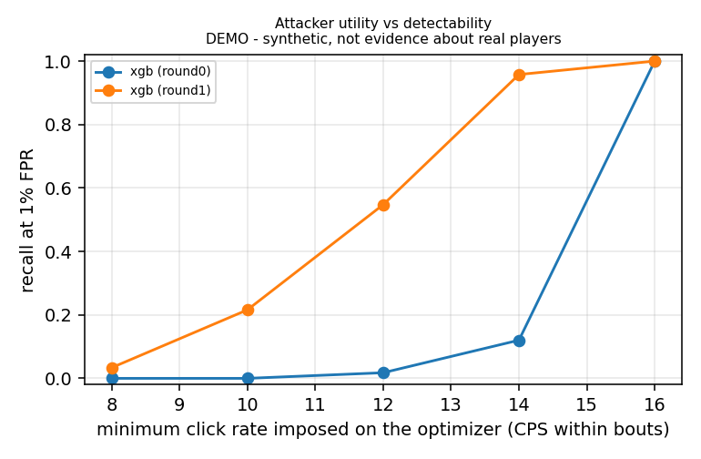

# Detecting Click Automation from Server-Observable Timing in Minecraft: A Reproducible Pipeline, an Adaptive-Adversary Evaluation, and What One Real Session Can and Cannot Show

*Alejandro Ramírez Arias — extension of the Bachelor's thesis "Cheating y anti-cheat en
videojuegos: enfoque de ciberdefensa y desarrollo de un detector server-side en Minecraft con
bastionado".*

> **Reading guide.** This report separates two kinds of result:
> - **REAL** results come from the pipeline running on the recorded sessions in `ml/data/raw/`.
>   Today that is one 65-second session from one participant.
> - **DEMO** results come from synthetic humans and synthetic adversaries and are marked
>   *DEMO - synthetic, not evidence about real players*. They show that the method and code
>   work, and how the detectors behave *under the stated assumptions*. They are not
>   measurements of real players.
>
> Every number below was produced by `ml/run_all.ps1`; the source tables are in `ml/results/`.

## Abstract

Server-side anti-cheat systems often detect autoclickers with a fixed rule: an inter-click
interval below 1000/15 ms is a violation. We extend a Paper 1.18.2 anti-cheat plugin with a
reproducible pipeline that records labelled sessions, cleans the event stream, extracts
window-level timing features, and evaluates threshold, unsupervised, supervised and sequence
models. Thresholds are calibrated on held-out humans and data are split by participant. Recall is
reported at fixed false-positive rates.

**REAL.** The first real session (one participant, 65 s) yields three observations:
- one physical click produces up to three server events, so the deployed detector measured the
  wrong quantity;
- held-button mining generates one swing per tick, so a naive switch to swing timing would flag
  56 of 76 intervals of legitimate play;
- intervals cluster on the 50 ms tick grid (73% of active intervals within ±5 ms, against 20%
  without quantization; n = 15, KS p = 0.014). A fixed-rate clicker is therefore *not* observed
  as zero-variance.

No real window survives cleaning, so no real detection metric can be reported yet.

**DEMO.** On synthetic data with placeholder humans:
- gradient-boosted trees reach recall 0.984 at a realised FPR of 0.8%, where the original rule
  flags 86% of synthetic human windows;
- an adversary that resamples the human interval distribution is nearly undetectable from
  timing alone (recall ≤ 0.20);
- an evolution-strategy adversary optimised against XGBoost drives its recall to 0.008, but is
  caught by other detectors;
- after adversarial training, a re-optimised adversary still evades half the windows;
- simulated lag raises the FPR of several models.

The trained model is exported to ONNX and integrated in the plugin off the main thread, behind a
fail-safe switch that defaults to the original detector.

## 1. Introduction and threat model

The thesis treats cheating as a defensive-security problem under a **man-at-the-end (MATE)**
threat model. The player controls the client, its memory and its input devices, so the server
can only judge the *observable consequences* of client behaviour [Collins et al. 2024;
Alangari & Alharbi 2025]. Click automation (autoclickers, macros) is a natural target because it
leaves a temporal trace: the sequence of attack swings the server receives. The thesis detector
flags any interval shorter than 66 ms (15 CPS) and accumulates violation levels (VL) before a
kick. Section 2.3 of the thesis already anticipates the weakness: an attacker can add jitter to
look human, while more complex models cost transparency.

This extension asks: **can a statistical/ML model detect click automation, with and without
jitter, from server-observable timing where fixed thresholds fail? How robust is it against an
adaptive adversary and against network lag?** The thesis priorities are kept:
- false positives are the costliest error;
- decisions must be explainable and auditable;
- the detector must not degrade server TPS;
- the extension must not weaken the existing hardening (RBAC, fail-safe configuration,
  auditing, asynchronous logging).

**Adversary capabilities assumed here.** The attacker can generate any sequence of click times
at the client: fixed rate, jittered, resampled from recorded human play, or optimised against a
known detector (white-box, adaptive). The attacker cannot change how the server timestamps
events, nor the client's 20 Hz tick, unless they modify the client. A modified client could send
swing packets at arbitrary times; this is noted as a limitation in Section 7. Out of scope:
perception cheats, and anything requiring client instrumentation.

## 2. Related work

- **Defence families.** The thesis reviews server-side, client-side and kernel-level anti-cheat.
  Alangari and Alharbi [2025] organise technical defences into server-side detection,
  client-side anti-tamper, kernel drivers and hardware-assisted TEEs. They compare them on
  detection effectiveness, overhead, privacy and scalability, and stress that server-side
  methods are less intrusive but see less of the client.
- **The attacker side.** Collins et al. [2024] study the cheat market and the sturdiness of
  client-side anti-cheat across 11 shooters. They find cheat prices track defensive sturdiness,
  which is the economic argument behind "raise the attacker's cost" used in the thesis.
- **Server-side ML.** Closest in spirit is HAWK [Zhang et al. 2024/2026], a server-side ML
  anti-cheat for CS:GO. It imitates human expert review with multi-view features and is
  evaluated on large real datasets; its emphasis on real-world data and expert-like explanations
  is exactly what this extension still lacks. Transformer-based detection from game telemetry
  has also been proposed (AntiCheatPT, arXiv:2508.06348).
- **Methods used.** Isolation Forest [Liu et al. 2008], One-Class SVM [Schölkopf et al. 2001],
  Random Forest [Breiman 2001], XGBoost [Chen & Guestrin 2016], and SHAP / TreeSHAP for
  explanations [Lundberg & Lee 2017; Lundberg et al. 2020].

## 3. Data and cleaning

### 3.1 Recording

`SessionRecorder` (`/ciberplugin record start <player> <label> <participant>`) writes labelled
sessions asynchronously through a bounded queue that counts dropped events (backpressure). It
records click events (`swing`, `interact_air`, `interact_block`), movement deltas with
on-ground, ping and TPS, block breaks, and a session summary.

### 3.2 REAL findings that shaped the design

The only real session is P01: 65 s, legacy label `human` → `human_unspecified`, 111 click events,
649 moves, 24 breaks, 0 dropped.

1. **One click, several events.** 34 of 110 raw gaps between click events are below 15 ms. A
   single press can produce `interact_block` (dig start), the `break`, `interact_air` (the
   server-side ray trace for the swing) and the `swing`. The deployed detector measured
   intervals between `interact_*` events, which mixes these.
2. **Held button = one swing per tick.** While the button is held the client sends a swing every
   tick (~50 ms). The real data show the `break` arriving *before* those swings when blocks break
   instantly. A held-button state machine handles this: a dig marker opens a run in which swings
   ≤ 65 ms apart are held. One late swing (≤ 85 ms, a slow server tick) does not end the run, but a
   skipped tick (~100 ms) does. Here 56 of 77 accepted swings are held.
3. **Quantization.** Intervals cluster on multiples of 50 ms (Figure 1).

   | intervals | n | within ±5 ms of the grid | KS vs uniform residuals |
   |---|---|---|---|
   | all (held + active) | 71 | 74.6% | p = 1.4e-8 |
   | active (real clicks) | 15 | 73.3% | p = 0.014 |

   Without quantization the expected share is 20%. This is consistent with the client handling
   mouse input once per 20 Hz client tick. The residual spread (MAD-based single-event
   σ ≈ 2.5 ms) is used to calibrate the jitter of every synthetic generator.
4. **Movement.** Moves start ~12 s after `/record start`. The spawn trim is therefore applied
   relative to the first move.
5. **Game mode.** All 24 breaks arrive ≤ 5 ms after the dig start, and there is sustained upward
   motion. Both suggest creative mode, a confound for every movement and break rule.

*Figure 1 (REAL). Accepted swing intervals and their residual to the 50 ms grid.*

### 3.3 Original rules on the real session (REAL, anecdotal)

| rule (thesis Annex I) | stream | violations |
|---|---|---|
| AutoClicker 0 < Δ < 66 ms | interact events, as deployed | 1 / 33 |
| | all raw events | 59 / 110 |
| | swings, de-duplicated, not held-filtered | 56 / 76 |
| | **cleaned** (held excluded) | **0 / 20** |
| FastBreak < 450 ms | break intervals | 15 / 23 |
| Speed > 0.5 (effective: `0.1` clamped to 0.5) | trimmed moves | 70 / 608 |
| Speed > 1.2 (thesis text) | trimmed moves | 0 / 608 |
| Fly: airborne and \|dy\| > 1 | trimmed moves | 7 / 608 (a fall) |

The session is human, so every violation is a false positive. With n = 1 these are
illustrations of failure modes, not rates.

## 4. Method

### 4.1 Windows and features

- **Windows:** 50 accepted swings with stride 25 (main), and 5 s with stride 2.5 s.
- **Interval selection:** for every window, the intervals ending in a non-held swing are kept.
  Pauses > 1 s are counted separately; a window needs ≥ 10 remaining intervals.
- **Features:** mean, std, coefficient of variation, skewness and excess kurtosis (biased
  moments), min, p05, p95, Shannon entropy of a fixed 25 ms histogram, lag-1 autocorrelation,
  maximum clicks in any 1 s, fraction of intervals within ±5 ms of a 50 ms multiple, duplicate
  fraction (swings merged by de-duplication), and pause fraction.
- **Routing:** windows with ≥ 50% held swings go to "mining" and are not scored.
- **Audit-only fields:** `held_frac`, ping and TPS are logged but deliberately **not** model
  inputs. As inputs they would create cheap evasion paths and a dependence on network
  conditions.
- **Exact port:** the definitions are written out explicitly so that the Java plugin
  reproduces them exactly. JUnit tests compare Java and Python on fixtures with tolerance 1e-6.

### 4.2 Detectors

1. **Original rule** (fixed, uncalibrated): a window is flagged if any interval has
   0 < Δ < 66 ms. It is applied to raw interact events and to cleaned intervals.
2. **cv_rule:** one explainable statistic with a calibrated threshold.
3. **Unsupervised, humans only:** Isolation Forest (300 trees), One-Class SVM (RBF, ν = 0.05).
4. **Supervised:** Random Forest (300 trees), XGBoost (300 trees, depth 4).
5. **Sequence model:** a 1D-CNN (two conv layers) on log-scaled interval sequences.

### 4.3 Evaluation protocol

- **Split:** StratifiedGroupKFold (5 folds) by **participant**.
- **Threshold placement:** inside each training fold, 25% of human participants are held out
  and used *only* to place thresholds at FPR targets of 1% and 0.1%. The test fold never
  influences fitting or thresholds.
- **Main metric:** recall at fixed FPR, with the realised test FPR reported alongside.
- **Other metrics:** PR-AUC, F1 and confusion counts at 1%, and a session-level alarm rate
  (≥ 3 flagged windows, mimicking VL accumulation).
- **Uncertainty:** 95% bootstrap intervals resample participants within class (1,000
  replicates).
- **Real data:** with one participant, leave-one-participant-out is impossible. The code runs
  the same protocol on real windows when ≥ 2 groups per class exist, and falls back to session
  grouping with an explicit warning.

### 4.4 Synthetic data (DEMO)

- **Humans:** 40 synthetic participants, each with 3 × 180 s combat sessions and 1 × 90 s
  held-button mining session.
  - Combat intervals come from a lognormal generator with AR(1) drift, geometric bouts, pauses
    and slow fatigue.
  - Hyper-parameters are **placeholders** (median 90–170 ms, log-sd 0.20–0.45, AR 0.1–0.5),
    because the real data contain 15 active intervals and the fitting routine requires ≥ 300.
    It switches automatically when that is reached.
- **Adversaries:** 24 synthetic participants per level × 3 sessions:
  - `none`: fixed 8–20 CPS;
  - `uniform`: ±10–50% jitter;
  - `gaussian`: 5–30% sd;
  - `human_like`: i.i.d. lognormal draws from the human hyper-distribution, i.e. matching
    marginals without temporal structure;
  - `optimized`: see Section 5.2.
  - All levels share the same bout structure.
- **Observation model:** all generators pass through the same model. Client-tick quantization
  (random phase, clicks in the same tick sent back-to-back) comes first, then Gaussian
  per-packet jitter (σ = 2.5 ms, from the real data), with TCP order preserved.

## 5. Experiments and results

### 5.1 Detection of standard autoclickers (DEMO)

50-click windows: 4,406 human and 16,902 attack windows, 40 human and 72 attacker participants.
Brackets are 95% participant-bootstrap CIs.

| detector | recall@1% | realised FPR | recall@0.1% | PR-AUC |
|---|---|---|---|---|
| original rule, raw events | 0.952 | 0.859 [0.791, 0.921] | – | – |
| original rule, cleaned | 0.952 | 0.859 | – | – |
| cv_rule | 0.286 [0.198, 0.370] | 0.014 | 0.195 | 0.978 |
| Isolation Forest | 0.741 [0.664, 0.813] | 0.022 | 0.360 | 0.995 |
| One-Class SVM | 0.916 [0.866, 0.959] | 0.016 | 0.607 | 0.997 |
| Random Forest | 0.986 [0.970, 0.998] | 0.009 | 0.700 | 1.000 |
| XGBoost | 0.984 [0.969, 0.996] | 0.008 | 0.921 [0.880, 0.956] | 1.000 |
| 1D-CNN | 0.834 [0.768, 0.891] | 0.020 | 0.764 | 0.993 |

**Reading this table honestly.**
- **The 86% FPR of the original rule** follows from quantization plus the *assumed* lower tail
  of placeholder humans: any true interval below ~75 ms is observed as 50 ms. Whether real fast
  clickers behave like this is unknown, and the one real session had 0 cleaned violations.
- **The 0.1% operating point** relies on ~950 calibration windows, so its threshold is close to
  the maximum human score seen. Realised FPRs at that target (0.1–0.4%) should be read as
  "≲ 0.5%".
- **5-second windows** give similar ranking. Session alarms are higher with them (XGBoost:
  16.7% of human sessions with ≥ 3 flagged windows vs 2.5% with 50-click windows), because
  overlapping short windows give more chances to fire.
- **What drives detection.** SHAP (Section 5.4) shows supervised models rely on the *shape* of
  the tick-count distribution: histogram entropy, mean, lag-1 autocorrelation. A fixed 12 CPS
  clicker produces a deterministic 50/100 ms pattern with strongly negative autocorrelation and
  low entropy.

### 5.2 Adaptive adversary and adversarial training (DEMO)

**Round 0.** Detectors are trained on humans + `none` only. The `optimized` adversary is a
(μ = 4, λ = 12) evolution strategy over (median, spread, AR coefficient, pause probability,
pause length), minimising the mean round-0 XGBoost score subject to ≥ 12 CPS within bouts. It
converged to a 40 ms median with large spread and frequent pauses, at 12.5 CPS.

**Round 1.** Adversarial training adds `uniform`, `gaussian`, `human_like` and `optimized`
participants. The new model is attacked again by a fresh optimisation, `optimized_r2`, which
converged to a 71 ms median, spread 0.30, AR 0.58, at 12.1 CPS.

Recall at 1% FPR:

| model | none | uniform | gaussian | human_like | optimized | optimized_r2 |
|---|---|---|---|---|---|---|
| XGBoost, round 0 | 1.000 | 0.908 | 0.960 | 0.059 | **0.008** | – |
| XGBoost, round 1 | 0.998 | 0.956 | 0.978 | 0.197 | 0.990 | **0.493** |
| Random Forest, round 1 | 0.993 | 0.963 | 0.973 | 0.162 | 0.930 | 0.329 |
| One-Class SVM (humans only) | 0.913 | 0.779 | 0.780 | 0.018 | 1.000 | 0.509 |
| original rule (FPR 86%) | 0.890 | 0.999 | 0.966 | 0.824 | 1.000 | 1.000 |

*Figure 2 (DEMO). Recall vs adversary level with participant-bootstrap CIs, before and after
adversarial training. Legends show each detector's realised human FPR.*

**Findings (DEMO).**
1. **Timing-only detection cannot separate a clicker that reproduces the human marginal
   distribution.** `human_like` recall stays ≤ 0.20 for every calibrated model. The remaining
   signal is temporal structure (drift, bursts, fatigue), which the placeholder humans have only
   weakly.
2. **Adaptive attacks overfit their target.** The round-0 optimum evades XGBoost (0.8%) yet is
   caught completely by One-Class SVM and by the original rule. This argues for combining
   heterogeneous detectors, consistent with the thesis's defence-in-depth stance.
3. **Adversarial training helps, but the game continues.** It recovers the round-0 attack
   (0.990), but a re-optimised attack still evades about half the windows (0.493). Human FPR at
   the 1% threshold changed from 1.4% to 1.7%, with overlapping CIs: no measurable cost here.
4. **The attacker pays in click rate.** Figure 3 shows the XGBoost utility frontier:

   | attacker's minimum CPS | 10 | 12 | 14 | 16 |
   |---|---|---|---|---|
   | recall, round 0 | 0.00 | 0.02 | 0.12 | 1.00 |
   | recall, round 1 | 0.22 | 0.55 | 0.96 | 1.00 |

   The detector does not stop automation; it caps the advantage automation can buy, which is
   the realistic "raise the cost" goal of the thesis.

*Figure 3 (DEMO). Recall vs the minimum click rate imposed on the optimiser.*

### 5.3 Network lag (SIMULATED; DEMO and REAL timestamps)

Lag was simulated: per-packet jitter of σ = 10% of the ping, plus Poisson lag spikes that release
queued packets together. The ping → (σ, spike-rate) mapping is an assumption. Detectors keep
their clean-data thresholds and are evaluated on a fresh synthetic human population.

Realised human FPR at the 1% threshold:

| ping (ms) | 0 | 20 | 80 | 150 | 250 |
|---|---|---|---|---|---|
| XGBoost | 0.028 | 0.024 | 0.025 | 0.043 | 0.019 |
| Random Forest | 0.026 | 0.025 | 0.014 | 0.011 | 0.007 |
| Isolation Forest | 0.009 | 0.028 | 0.087 | 0.305 | 0.529 |
| One-Class SVM | 0.013 | 0.079 | 1.000 | 1.000 | 1.000 |

- Even at ping 0 the tree models' realised FPR on this *new* population (2.6–2.8%) exceeds the
  1% calibration target: thresholds transfer imperfectly across populations.
- The novelty detectors are fragile under lag; tree models are less affected.
- Random Forest recall on attackers falls to 0.42 at 250 ms.
- **Real timestamps + simulated lag:** jitter spreads P01's held swings beyond the held tolerance,
  so some mining swings are evaluated as clicks. Averaged over 20 draws, cleaned original-rule
  violations go from 0 to 1.6 (ping 80), 6.65 (ping 150) and 9.15 (ping 250). With the first
  version of the rule, where any gap above 65 ms ended the run, they were 8.7, 16.4 and 13.95.
  The late-tick tolerance was introduced after the manual server test described in Section 6.
  Real lag measurements are still needed (protocol in `docs/real_lag_test_protocol.md`).

### 5.4 Explainability (DEMO model)

TreeSHAP on the exported XGBoost ranks:
1. histogram entropy (mean |SHAP| 3.89 log-odds);
2. mean interval (1.91);
3. lag-1 autocorrelation (1.13);
4. std (1.08);
5. p95 (1.00).

Permutation importance is near zero for all features. This is not a contradiction: the features
are redundant and PR-AUC is saturated, so permuting one is compensated by the others. Report
both, and prefer SHAP for per-decision explanations.

Each decision becomes an audit-log line. Example, a fixed clicker:

> `[ML-AutoClicker] FLAG (+1 VL) | score=1.000 threshold=0.964 (1% FPR on calibration humans;
> DEMO model) | window=50 swings, 48 active intervals, held_frac=0.00 | reasons: entropy=1.98
> (typical human 2.83) raises suspicion by 3.88 log-odds; mean=78.2 (typical human 149) …;
> ac1=-0.798 (typical human 0.002) …`

The third example in `ml/results/phase_g_results.md` is a **false positive on a synthetic
human**, driven by an extreme kurtosis (38.9) from one long interval. It shows why explanations
belong in the audit trail: a reviewer can see that the evidence is a single outlier, not
machine-like regularity.

## 6. Integration in the plugin

The extension follows the thesis's operational constraints.

- **Detector fix (all modes).**
  - The AutoClicker check now uses the arm swing as the click source, de-duplicated at 15 ms.
  - Held-button swings are excluded, with `LEFT_CLICK_BLOCK` and block breaks as dig markers.
  - Thresholds, VL scoring, RBAC bypass and asynchronous logging are unchanged.
- **ML engine.**
  - `ClickFeatureExtractor` (exact Java port) and `ClickModel` (ONNX Runtime, the only class
    that depends on it).
  - `MlClickDetector`: the main thread only appends swings. Every 25 swings a 50-swing snapshot
    goes to one background thread with a bounded queue, which drops and counts instead of
    blocking a tick. Resulting flags return to the main thread and feed `flagPlayer`.
  - The selected model is XGBoost: best recall at 1% FPR, and within 1 point of RF while being
    14× smaller (183 KB).
  - ONNX inference costs ~25–45 µs per window (median over two runs, Python onnxruntime on the development
    machine; not measured inside the server).
- **Fail-safe switch.**
  - `deteccion.autoclicker.engine: threshold | shadow | ml`, default `threshold`.
  - Invalid values, a missing ONNX Runtime or model, or a feature-order mismatch all fall back
    to the threshold detector with a warning.
  - `shadow` logs scores to `ml_shadow.csv` without adding VL, which is the intended way to
    validate on real players.
- **Privacy.**
  - The truncated UUID (`xxxxxxxx-XXXX-XXXX`), which keeps 32 bits of a public identifier, is
    replaced in `auditoria.log`, `telemetria_ml.csv` and `ml_shadow.csv` by
    `p-` + 64 bits of HMAC-SHA256(secret, UUID).
  - The key is generated with `SecureRandom` on first run and stored in the server's
    `config.yml`, never in the repository.
- **Verification.**
  - 11 JUnit tests: cleaner cases, Java↔Python feature and ONNX parity (max |Δ| 3e-7 in
    Python↔ONNX), the ML-thread hand-off, and the RFC 4231 HMAC test vector.
  - The jar builds with `gradlew build`. A manual test on a local Paper 1.18.2 server
    confirmed that ONNX Runtime is fetched by the library loader, the model loads in `shadow`
    mode, the HMAC key is generated, and audit and telemetry lines carry `p-…` pseudonyms.
- **Fixes motivated by the manual server test.** In ~35 s of legitimate play the player was
  kicked twice:
  - **AutoClicker while mining.** One held swing arrived 67 ms after the previous one (a slow
    tick), the held rule treated it as a release, and the rest of the run was evaluated as
    clicking. Fixed with the 85 ms release gap (Python and Java, with the observed sequence as a
    unit test).
  - **FastBreak.** Breaks every ~300 ms in creative mode were flagged by the fixed 450 ms rule.
    FastBreak now compares the time spent digging *that* block with the time expected from
    `Block#getBreakSpeed(Player)` (block hardness, tool, enchantments, effects, water, on-ground).
    It flags only breaks faster than 70% of that time, the same margin the vanilla server
    accepts, and skips creative and spectator players.
  - **Fly.** A normal fall was flagged because the rule used `|dy| > 1` while airborne. It now
    flags only anomalous *ascent* (`dy > 1`, a normal jump rises 0.42 blocks/tick).
  - **Movement exemptions.** Speed, Fly and No-Clip skip creative/spectator players and players
    who are allowed to fly, gliding with an elytra, riptiding or riding a vehicle.

  The Python baselines in Section 3.3 still reproduce the *original* thesis rules, so that the
  comparison with the original detector stays visible.

## 7. Limitations and ethics

**Limitations.**
- **Held-button rule under lag.** The late-tick tolerance (Section 6) reduces, but does not
  remove, false AutoClicker flags under jitter (Section 5.3). The 85 ms release gap is a
  compromise: it absorbs one slow tick without letting a 50/100 ms clicker pass as mining.
- **Evidence.** There is no real-data detection result: one participant, one 65 s session,
  probably in creative mode, and zero scoreable windows. Every detection number is DEMO and
  depends on assumed human parameters. The direction of some conclusions (e.g. the original
  rule's FPR) could change with real data.
- **Observation.** Tick quantization removes sub-tick timing. A client modified to send swing
  packets outside its tick loop could produce sub-tick timing the observation model does not
  include.
- **Evasion paths.**
  - Held-button routing can be abused by clicking on a block at tick rate.
  - Ping and TPS are not used as inputs, so detectors do not adapt to lag; the thesis's
    "conservative mode under poor network conditions" remains future work.
- **Attack model.** One optimiser with a small budget and one objective. Stronger attacks
  (gradient-free with larger budgets, or targeting an ensemble) were not run, so the adversarial
  results are optimistic for the defender.
- **Statistics.**
  - Windows overlap, and synthetic participants are i.i.d. draws from one hyper-distribution,
    so CIs do not capture between-population shift. Phase F shows the tree models' FPR rising
    from 1% to 2.6–2.8% on a new synthetic population even without lag.
  - 0.1% FPR is not resolvable with the current calibration sets.
- **Movement.** Movement ML (speed/fly) was not attempted: there are no labelled movement-cheat
  sessions.

**Ethics.**
- **Consent and data handling.** Recording players' input timing requires informed consent,
  minimisation and retention limits. The recorder stores no names or chat, participants are
  coded, and raw data are git-ignored. The new pseudonyms are keyed so that published logs
  cannot be linked to public UUIDs without the server's secret. This is still pseudonymisation,
  not anonymisation.
- **False positives.** A false positive is an unjust sanction. The integration therefore
  defaults to the original detector, recommends `shadow` mode until real validation exists, and
  attaches human-readable evidence to every ML decision.
- **Dual use.** The adversary generators produce only numeric interval sequences for offline
  evaluation; no input-injection or cheat tooling was written.

## 8. Future work

1. **Real data first.** At least 10 participants (≥ 30 for a 0.1% FPR operating point), each
   with combat, mining and exploration sessions in survival mode, plus labelled clicker
   sessions from several machines on the lab server.
   Re-run `run_all.ps1`; the real track activates automatically.
2. **Real lag.** Repeat Phase F with `tc netem` / clumsy, and measure the actual per-packet
   jitter from `moves.csv` inter-arrival times. Make the held-button tolerance adaptive if needed.
3. **Valid stress test.** Use headless test clients generating high-frequency events, measuring
   TPS/MSPT, recorder drops and ML-queue drops, to exercise the event-handling and
   asynchronous logging paths directly.
4. **Detector ensemble and VL policy.** Combine heterogeneous detectors (Section 5.2), and
   study how window flags should accumulate into VL under a session-level FPR budget.
5. **Movement models**, once `speed_mod` / `fly_mod` sessions exist (features are already
   implemented).

## References

- Alangari, A., Alharbi, O. (2025). *A Systematic Review of Technical Defenses Against
  Software-Based Cheating in Online Multiplayer Games.* arXiv:2512.21377.
- Breiman, L. (2001). Random Forests. *Machine Learning* 45, 5–32.
- Chen, T., Guestrin, C. (2016). XGBoost: A Scalable Tree Boosting System. *KDD 2016*.
- Collins, S., Poulopoulos, A., Muench, M., Chothia, T. (2024). Anti-Cheat: Attacks and the
  Effectiveness of Client-Side Defences. *CheckMATE '24 (workshop co-located with ACM CCS 2024)*,
  pp. 30–43. doi:10.1145/3689934.3690816.
- Liu, F. T., Ting, K. M., Zhou, Z.-H. (2008). Isolation Forest. *IEEE ICDM 2008*.
- Lundberg, S. M., Lee, S.-I. (2017). A Unified Approach to Interpreting Model Predictions.
  *NeurIPS 2017*.
- Lundberg, S. M. et al. (2020). From local explanations to global understanding with
  explainable AI for trees. *Nature Machine Intelligence* 2, 56–67.
- Schölkopf, B., Platt, J., Shawe-Taylor, J., Smola, A., Williamson, R. (2001). Estimating the
  Support of a High-Dimensional Distribution. *Neural Computation* 13(7).
- Zhang, J., Sun, C., Gu, Y., Zhang, Q., Lin, J., Du, X., Qian, C. (2024). Identify As A Human
  Does: A Pathfinder of Next-Generation Anti-Cheat Framework for First-Person Shooter Games.
  arXiv:2409.14830; published in *IEEE TIFS* 21: 240–255 (2026).
- *AntiCheatPT: A Transformer-Based Approach to Cheat Detection in Competitive Computer Games.*
  arXiv:2508.06348 (2025).
- Thesis references kept as grey literature for context: BattlEye FAQ (2025); Riot Games (2020);
  Miller (2016); XDA Developers (2024); Acer Tech Blog (2024).
