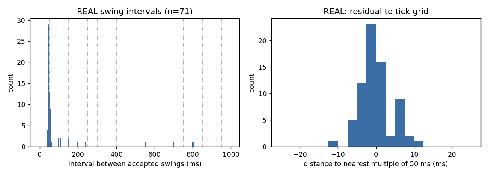
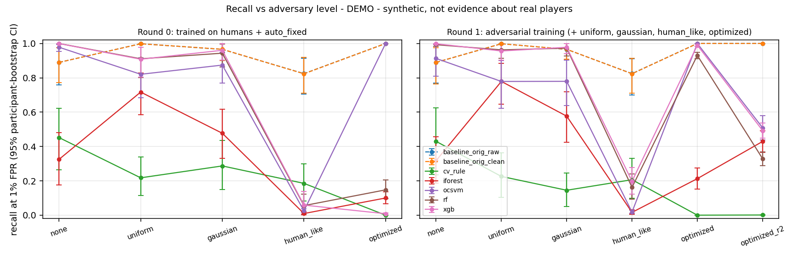

# ML extension: click-automation detection from server-observable timing

This extends the TFG's server-side anti-cheat (Minecraft Java, Paper 1.18.2) with a reproducible
ML pipeline. It keeps the same threat model (man-at-the-end), the same emphasis on false
positives, explainability, auditability and low server impact, and the same terminology
(VL, *bastionado*, fail-safe).

**Research question.** Can a statistical/ML model detect click automation (autoclickers with and
without jitter) from server-observable timing where fixed thresholds fail? How robust is it
against an adaptive adversary and against network lag?

> **Read this first: what is real and what is DEMO.** The real dataset is currently **one 65 s
> session from one participant (P01)**. It is enough for the data report, for the per-event
> behaviour of the original thesis rules, and for the timing-quantization observation. It is
> **not** enough for any detection metric: no real window survives cleaning (0 scoreable windows).
> Every recall/FPR/PR-AUC number below comes from **synthetic humans and synthetic adversaries**
> and is marked **DEMO - synthetic, not evidence about real players**.

## Reproduce

```powershell
# from the repository root (main checkout, where ml\data\raw\ lives)
.\ml\run_all.ps1
# options: -RawDir <folder>  -WithCnn (installs PyTorch CPU for the 1D-CNN)  -SkipJava
```

What it does:
1. Creates `ml\.venv` (Python 3.12) and installs `requirements-lock.txt`, the exact lock (direct
   pins are in `requirements.txt`).
2. Runs the unit tests (29) and phases A–H.
3. Rebuilds the plugin with `gradlew build`, which runs 11 JUnit tests, including Java↔Python
   parity of the features and of the ONNX scores.

A full run takes ~5 min on a laptop CPU. A clean re-run reproduced every reported number (seeds
are fixed; differences appear only in the last digit of one bootstrap bound).

Steps one by one: `python -m src.data | src.synthetic | src.features | src.evaluate |
src.adversarial | src.lag | src.explain | src.export_onnx` (run from `ml\`, with `ML_RAW_DIR`
pointing at the raw folder).

## Layout

| path | content |
|---|---|
| `src/config.py` | constants shared with Java (marked `JAVA`), original thesis thresholds, seeds |
| `src/data.py` | **A** loading, schema validation, label normalisation, cleaning, quantization analysis, `results/data_report.md` |
| `src/observation.py` | client-tick quantization + network jitter model used by every generator |
| `src/synth_humans.py`, `src/adversary.py`, `src/synthetic.py` | **B** synthetic humans and adversaries (numeric sequences only) |
| `src/features.py` | **C** window features (50 clicks and 5 s, 50% overlap), movement features |
| `src/train.py`, `src/evaluate.py` | **D** detectors and participant-grouped evaluation |
| `src/adversarial.py` | **E** adversary levels, evolutionary attacker, adversarial training |
| `src/lag.py` | **F** simulated lag (see `docs/TODO_real_lag_tests.md` for real tests) |
| `src/explain.py` | **G** SHAP, permutation importance, audit-log explanations |
| `src/export_onnx.py` | **H** ONNX export, parity check, Java fixtures, latency |
| `results/` | figures, tables, `data_report.md`, `phase_[d-g]_results.md`, exported model |
| `data/raw/` | real sessions, **git-ignored, never commit** |
| `data/processed/` | derived data, git-ignored (contains real-derived data) |

## Data format

SessionRecorder (`/ciberplugin record start <player> <label> <participant>`) writes four CSVs per
participant folder (comma separator, dot decimals; `t_ns` = ns since session start):

- `clicks.csv`: `session_id,t_ns,source,label`, with `source` ∈ swing | interact_air | interact_block
- `moves.csv`: `session_id,t_ns,dx,dy,dz,on_ground,tps,ping,label`
- `breaks.csv`: `session_id,t_ns,label`
- `sessions.csv`: `session_id,participant,label,start_utc,end_utc,duration_s,events_dropped`

Labels: `human_combat`, `human_mining`, `human_explore`, `auto_fixed`, `auto_jitter`,
`speed_mod`, `fly_mod`; the legacy `human` maps to `human_unspecified`. Synthetic rows carry
`origin = synthetic` and are written as `data/processed/synthetic_*.csv`.

## Method in one page

**Cleaning.** These rules were derived from the real session and are identical in Python
(`data.clean_click_stream`) and Java (`ClickStreamCleaner`):
- **Click source:** only `swing` is a click.
- **De-duplication:** a swing within 15 ms of the last accepted swing is a duplicate. It is
  counted (`dup_frac`), not used as a click.
- **Held-button state machine:** `interact_block` or a break opens a dig. While consecutive
  swings stay ≤ 65 ms apart they are *held* (the client sends one swing per tick while the
  button is held). In the real data the break arrives *before* the held swings when blocks
  break instantly.
- **Moves:** trimmed 5 s after the **first move** (moves start ~12 s after `/record start`).

**Windows and features.**
- Windows of 50 accepted swings (stride 25) and of 5 s (stride 2.5 s).
- Statistics use the intervals of non-held swings, excluding pauses > 1 s.
- Features: mean, std, cv, skew, kurtosis, min, p05, p95, histogram entropy (25 ms bins),
  lag-1 autocorrelation, max clicks in 1 s, fraction of intervals within ±5 ms of a 50 ms
  multiple, duplicate fraction, pause fraction.
- Windows with ≥ 50% held swings are routed to "mining" and not scored.
- `held_frac`, ping and TPS are kept for audit but are not model inputs: as inputs they would
  teach "mining-like ⇒ human" and "high ping ⇒ …", which an attacker could exploit.

**Detectors.**
- Original thesis rule, fixed (flag if any interval satisfies 0 < diff < 66 ms, i.e.
  1000/15 with Java integer division), on raw interact events (`baseline_orig_raw`) and on
  cleaned intervals (`baseline_orig_clean`).
- A calibrated one-statistic rule (`cv_rule`).
- Isolation Forest and One-Class SVM trained on humans only.
- Random Forest, XGBoost, and an optional small 1D-CNN on interval sequences.

**Protocol.**
- StratifiedGroupKFold (5) by **participant**.
- Inside each training fold, 25% of the human participants are held out **only** to place the
  threshold at the target FPR. The test fold is never used for fitting or thresholds.
- Metrics: recall at FPR ≤ 0.1% and ≤ 1% (the realised test FPR is reported too), PR-AUC, F1
  and confusion counts at 1%, session alarms (≥ 3 flagged windows), and 95% bootstrap CIs
  resampling participants within class.
- With one real participant, leave-one-participant-out is impossible. The real track runs
  automatically when ≥ 2 groups per class exist, and falls back to session grouping with a
  printed limitation.

**Synthetic data.**
- *Humans:* a lognormal generator with AR(1) rhythm drift, bouts, pauses and fatigue. Its
  hyper-parameters are **placeholders** (`synth_humans.PLACEHOLDER_HYPER`: median 90–170 ms,
  log-sd 0.20–0.45, …), because the real data have 15 active intervals and the fit needs ≥ 300.
  It switches to fitted parameters automatically. Held-button mining sessions are included.
- *Adversaries:* `none` (fixed 8–20 CPS), `uniform` and `gaussian` jitter, `human_like` (i.i.d.
  draws from the human marginal) and `optimized`. The optimized level is a (μ, λ) evolution
  strategy that minimises a chosen detector's mean score while keeping ≥ 12 CPS within bouts.
- *Observation:* every generator goes through the same observation model. Client-tick
  quantization comes first, then per-packet jitter (σ = 2.5 ms, **calibrated from the real
  interval residuals**, n = 71), keeping TCP order.

## Results summary

### Real data (`results/data_report.md`)

- **One physical click = up to three events.** 34 of 110 raw click-event gaps are < 15 ms.
- **Original AutoClicker rule, per event, on the human session:**

  | stream | violations / intervals |
  |---|---|
  | naive interact events, as the Java code saw them | 1 / 33 |
  | all raw events | 59 / 110 |
  | swings, de-duplicated but **not** held-filtered | 56 / 76 |
  | cleaned (held excluded) | **0 / 20** |

  Switching to swings is only safe together with held-button exclusion.
- **Other original rules on legitimate play:** FastBreak 15 / 23 break intervals; Fly 7 (a
  fall); speed > 0.5 (effective clamped threshold) 70 / 608 moves, speed > 1.2 0 / 608. All
  breaks were instant (24 / 24), which suggests creative mode. Anecdotal: n = 1 session.
- **Timing is quantized to the 50 ms tick grid.** 73% of real *active* click intervals lie
  within ±5 ms of a 50 ms multiple, against 20% without quantization (n = 15, KS p = 0.014).
  See .
- **Simulated lag on the real timestamps** (`phase_f_results.md`): jitter of ≥ 8 ms breaks the
  held-button rule. Cleaned-rule violations rise from 0 to 8.7 (ping 80) and 16.4 (ping 150) on
  average over 20 draws. This is a weakness of the cleaning rule that real lag tests must
  quantify.

### DEMO - synthetic, not evidence about real players

Phase D (50-click windows, 4,406 human / 16,902 attack windows, 40 + 72 participants):

| detector | recall @ FPR 1% | realised FPR | recall @ FPR 0.1% | PR-AUC |
|---|---|---|---|---|
| original rule (fixed) | 0.952 | **0.859** | – | – |
| cv_rule | 0.286 | 0.014 | 0.195 | 0.978 |
| Isolation Forest | 0.741 | 0.022 | 0.360 | 0.995 |
| One-Class SVM | 0.916 | 0.016 | 0.607 | 0.997 |
| Random Forest | 0.986 | 0.009 | 0.700 | 1.000 |
| XGBoost | 0.984 | 0.008 | 0.921 | 1.000 |
| 1D-CNN | 0.834 | 0.020 | 0.764 | 0.993 |

Points to keep in mind:
- The original rule's 86% FPR on *synthetic* humans comes from the placeholder's assumed lower
  tail (true intervals < ~75 ms are observed as 50 ms). It says nothing about real players.
- The 0.1% operating point is at the resolution limit of ~950 calibration windows.
- 95% CIs are in `results/phase_d_results.md`.

Phase E (adversarial; recall at 1% FPR, XGBoost):

| | none | uniform | gaussian | human_like | optimized | optimized_r2 |
|---|---|---|---|---|---|---|
| trained on humans + auto_fixed | 1.000 | 0.908 | 0.960 | 0.059 | 0.008 | – |
| adversarial training | 0.998 | 0.956 | 0.978 | 0.197 | 0.990 | **0.493** |

- An adversary that resamples the human marginal (`human_like`) is nearly invisible to
  timing-only models.
- An adversary optimised against XGBoost evades it, yet is caught 100% by One-Class SVM and by
  the fixed rule: it overfits the targeted model.
- After adversarial training, a *re-optimised* adversary still evades about half of the windows.
- Human FPR at the 1% threshold moved from 1.4% to 1.7% (overlapping CIs).
- Utility frontier: forcing the attacker to ≥ 14 CPS gives recall 0.96 after adversarial
  training; at 10 CPS, 0.22.

See .

Phase F (simulated lag, fresh synthetic humans): XGBoost FPR goes 2.8% → 7.6% → 12.3% at ping
0 / 80 / 150 ms. RF stays ≤ 2.6% but loses recall at 250 ms (0.42). One-Class SVM reaches 100%
FPR from 80 ms.

Phase G: SHAP ranks histogram entropy, mean interval and lag-1 autocorrelation first.
Permutation importance is ~0 because the features are redundant and PR-AUC is saturated.
`phase_g_results.md` shows three decisions as audit-log lines, including a false positive on a
human.

**Plugin.**
- The XGBoost model is selected by the documented rule: best recall at 1% FPR, and if within 1
  point, the smaller model. 183 KB vs 2.5 MB for RF.
- It ships as `models/click_model.onnx` with Python/ONNX parity of 3e-7.
- Inference is ~25 µs per window (Python onnxruntime on this machine; not measured inside the
  server).
- It runs on a background thread, and the default `engine: threshold` keeps it off. Use
  `shadow` to log scores without VL.

## Limitations

- **No real-data detection result yet**: one participant, one 65 s session, probably creative
  mode, 0 scoreable windows.
- Synthetic humans use **assumed** parameters. Every DEMO number depends on them, especially
  the fixed rule's FPR and the separability of `human_like`.
- **Timing quantization** (client 20 Hz tick, a few ms of jitter) removes most sub-tick
  information. What remains is the distribution and sequence of tick counts.
- The **held-button exclusion is an evasion path**: an autoclicker hitting a block at tick rate
  is routed to "mining". It is also fragile under jitter (Phase F). Both need real-data checks.
- Lag robustness is **simulated**, with an assumed ping→jitter mapping.
- One optimizer (ES, small budget) and one objective (mean XGBoost score). Stronger adaptive
  attacks are possible, so recall against `optimized*` is an upper bound on robustness, not a
  guarantee.
- Movement ML (speed/fly) was not attempted: there are no labelled cheat sessions, and the 13
  real movement windows are only summarised (`tables/real_movement_window_summary.csv`).

See also `docs/ml_report.md` (paper-style report), `docs/thesis_inconsistencies.md` and
`docs/NEXT_STEPS_FOR_ALEJANDRO.md`.

## Decisions taken without asking (and why)

- **Branch:** `ml-extension` was created inside the session's git worktree. Your uncommitted
  SessionRecorder work was copied from the main checkout into it (first commit). The main
  checkout was not modified.
- **Raw data path:** `ML_RAW_DIR` / `-RawDir`, because the worktree has no `ml/data/raw`.
- **Held swings arrive at ~50 ms, not ~200 ms**, in the real data (one swing per client tick).
  The held rule uses 65 ms.
- **Python feature definitions** use biased moments and explicit percentiles so that Java can
  match them exactly.
- **`held_frac`, ping and TPS are not model inputs** (see Method).
- **Default plugin engine is `threshold`** because the model is a DEMO.
